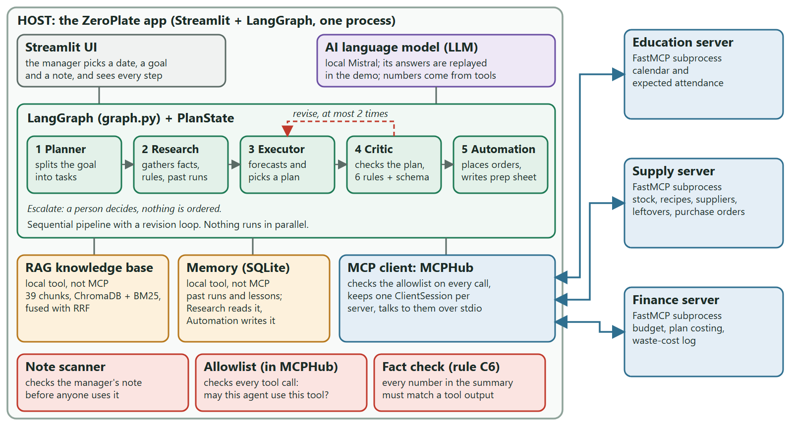
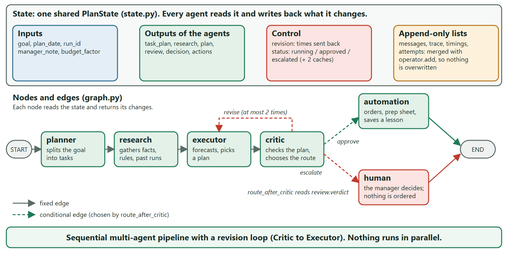
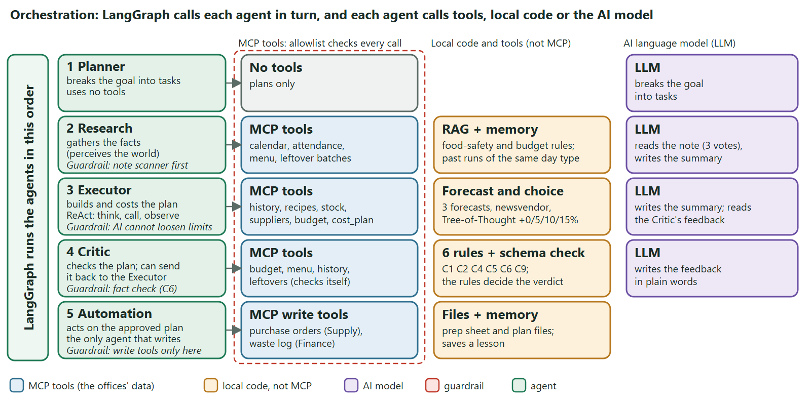
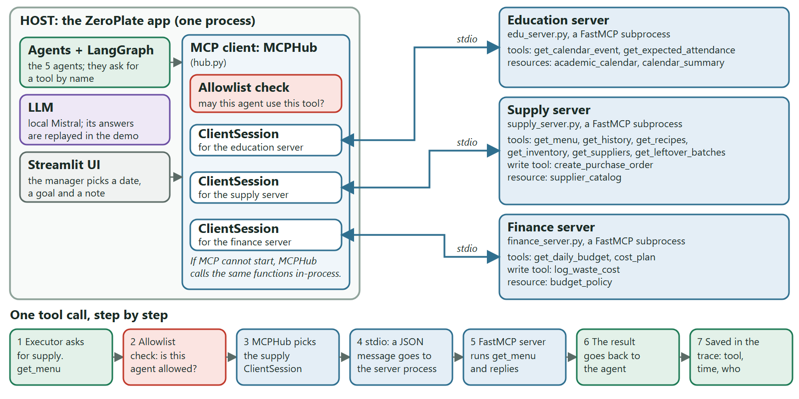
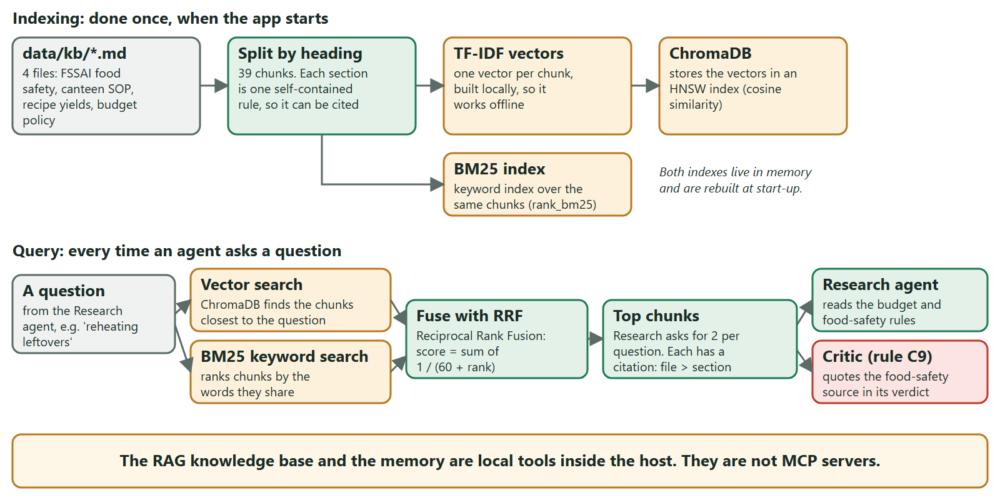

# ZeroPlate

A cross-domain agentic AI planner for a college canteen. Five agents use tools owned by three departments (academics, the store and accounts) to decide how much of each dish to cook: as little waste as possible, no shortages, within the daily budget and food-safety rules.

CA-3 proof of concept for *Foundations of Agentic AI* (SIT Pune). All data is synthetic.

## Final submission materials

Everything submitted for CA-3 is in [`ZeroPlate_final_submission_materials/`](ZeroPlate_final_submission_materials/):

| File | What it is |
|---|---|
| [Presentation (PDF)](ZeroPlate_final_submission_materials/ZeroPlate_CA3_presentation.pdf) | Slide deck, viewable on GitHub |
| [Presentation (PPTX)](ZeroPlate_final_submission_materials/ZeroPlate_CA3_presentation.pptx) | Editable slide deck (download to open) |
| [Problem statement and domain](ZeroPlate_final_submission_materials/ZeroPlate_problem_statement_and_domain.pdf) | One-page problem and domain note |

### Architecture: the complete system



### 1. LangGraph: state, nodes and edges



### 2. Orchestration layer: agent and tool calls



### 3. MCP layer: host, client and servers



### 4. RAG: knowledge base retrieval



## How it works

```
Streamlit UI -> Planner -> Research -> Executor -> Critic --approve--> Business Automation
                                          ^          |--revise (max 2)--'
                                          |__________|--escalate--> human decision
```

| Agent | Job |
|---|---|
| Planner | Breaks the goal into tasks (supervisor) |
| Research | Reads the academic calendar, attendance, menu and leftovers; searches the knowledge base; recalls past runs; reads the manager's note (after an injection check) |
| Executor | Forecasts demand (ensemble of three methods), scores candidate quantities by expected utility (stocking calculation), works out ingredients, purchases and cost |
| Critic | Checks six rules (event-aware range, forecast band, budget, dietary fairness, fact check, FSSAI leftover safety); approves, sends back with feedback, or escalates |
| Business Automation | Raises purchase orders, logs expected waste cost, writes the prep sheet, saves a lesson to memory |

- **Tools over MCP:** each department is its own MCP server (`education`, `supply`, `finance`), started as a separate process over stdio. A hub discovers the tools and enforces a per-agent allowlist; only Business Automation may use write tools.
- **Knowledge base:** Markdown rules chunked by heading, TF-IDF vectors in ChromaDB plus BM25, merged by reciprocal rank fusion.
- **Memory:** short-term = the LangGraph state of a run; long-term = SQLite of past runs.
- **Language model:** a local model through Ollama. Its answers are recorded once and replayed in the demo; tests use a deterministic rule-based policy. Numbers always come from tools, and the Critic fact-checks every number the model writes.

## Setup (Windows, Python 3.11)

```bash
py -3.11 -m venv .venv
.venv\Scripts\python -m pip install -r requirements.txt
.venv\Scripts\python scripts\check_env.py
```

`check_env.py` should report every check as OK.

## Run

```bash
.venv\Scripts\streamlit run app.py
```

Pick a scenario in the sidebar and press **Run the agents**. Scenario S1 (college fest) shows the whole loop: the Critic rejects the plan for unsafe leftovers, then for going over budget, and approves the third attempt.

Until the project dataset exists in `data/raw` and `data/kb`, the app uses the sample data in `tests/fixtures` (a banner says so).

### Optional: the local language model

```bash
ollama pull mistral
.venv\Scripts\python scripts\record_answers.py
```

This records the model's answers to `data/recordings/answers.json`. The app replays them by default. To call the model live, choose `ollama` under *Advanced* in the sidebar.

## Tests and evaluation

```bash
.venv\Scripts\python -m pytest -q
set PYTHONPATH=src
.venv\Scripts\python -m zeroplate.eval.run_eval --mcp
```

The eval command (needs `PYTHONPATH=src`, set on the line above; or run it from the app's *Evaluation* view) runs six benchmark scenarios and a 30-day held-out backtest against the canteen's old habit of cooking last week's sales plus 15%.

## Project layout

```
app.py                     Streamlit interface
src/zeroplate/
  agents/                  the five agents
  graph.py                 LangGraph orchestration
  mcp_servers/             supply and finance MCP servers (education: see below)
  mcp_client/              MCP hub and tool allowlist
  domain/                  forecast, stocking calculation, costing (pure functions)
  guardrails/              injection check, fact check, FSSAI rule, Critic rules
  llm/                     model client: deterministic / ollama / record / replay
  rag/  memory/            knowledge-base search, long-term memory
  eval/                    scenarios and evaluation harness
tests/                     tests and sample fixture data
```

The Education MCP server lives at `src/zeroplate/mcp_servers/edu_server.py`. Until it is added, the hub uses a test stand-in from `tests/fixtures/education_stub.py`.
