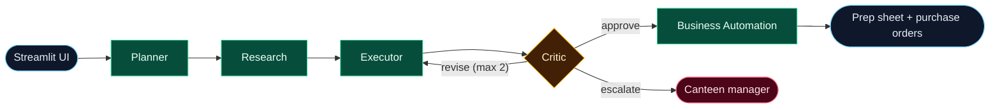
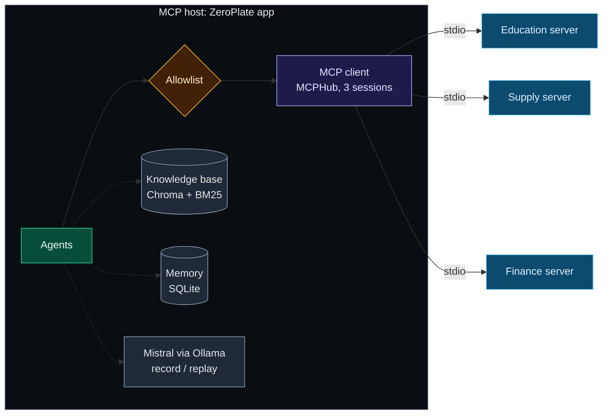
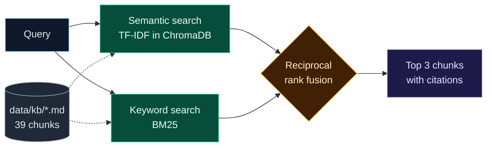

<div align="center">

# ZeroPlate

**A cross-domain agentic AI planner for the college canteen**<br>
Five agents, three departments, one goal: *cook what will be eaten.*


CA-3 proof of concept for *Foundations of Agentic AI*, SIT Pune · Anhad Mahajan and Aman Saxena<br>
All data in this project is synthetic.

</div>

---

## The problem

A college canteen cooks before it knows who will come. Three offices each hold part of the answer, but nobody combines them:

| Department | Knows | MCP server |
|---|---|---|
| **Education** (academic office) | exam days, holidays, fests, expected attendance | `edu_server` |
| **Supply** (canteen store) | stock, recipes, leftovers, suppliers | `supply_server` |
| **Finance** (accounts) | the daily budget and the cost of a plan | `finance_server` |

ZeroPlate's agents ask all three, then decide how much of each dish to cook: as little waste as possible, no shortages, within budget and FSSAI food-safety rules.

## Final submission

Everything submitted for CA-3 is in [`Final submission/`](Final%20submission/):

| | File |
|---|---|
| Presentation | [PDF](Final%20submission/ZeroPlate_CA3_presentation.pdf) (viewable on GitHub) · [PPTX](Final%20submission/ZeroPlate_CA3_presentation.pptx) (download) |
| Problem statement and domain | [PDF](Final%20submission/ZeroPlate_problem_statement_and_domain.pdf) |

### Complete architecture


<details>
<summary><b>1. LangGraph: state, nodes and edges</b></summary>


</details>

<details>
<summary><b>2. Orchestration layer: agent and tool calls</b></summary>


</details>

<details>
<summary><b>3. MCP layer: host, client and servers</b></summary>


</details>

<details>
<summary><b>4. RAG: knowledge-base retrieval</b></summary>


</details>

## How it works

The agents run **sequentially** in one LangGraph graph, with a reflection loop: the Critic can send a plan back to the Executor at most twice, then hands the decision to a person.



| Agent | Job |
|---|---|
| **Planner** | Breaks the goal into tasks (the language model does the decomposition) |
| **Research** | Reads the calendar, attendance, menu and leftovers; searches the knowledge base; recalls past runs; reads the manager's note after an injection check |
| **Executor** | ReAct loop: forecasts demand (median of three methods), scores Tree-of-Thought branches (+0/5/10/15%) by expected utility, then costs the plan |
| **Critic** | Checks six rules (C1 event-aware range, C2 forecast band, C4 budget, C5 dietary fairness, C6 fact check, C9 FSSAI leftover safety); approves, revises or escalates |
| **Business Automation** | The only agent with write tools: raises purchase orders, writes the prep sheet, saves a lesson to memory |

### Tools over MCP

The ZeroPlate app is the **MCP host**. Inside it, the **MCP client** (`MCPHub`) keeps one session per server over stdio and checks every call against a per-agent allowlist.



### Retrieval (RAG)



- **Memory:** short-term memory is the LangGraph state of a run; long-term memory is a SQLite store of past runs.
- **Language model:** Mistral through Ollama does real work in three places: planning, reading the manager's note, and writing the Critic's feedback. Its answers are recorded once and replayed in the demo. Every number comes from a tool, and the Critic fact-checks every number the model writes.
- **Guardrails:** prompt-injection check on the manager's note, tool allowlist (least privilege), C6 fact check, C9 FSSAI rule.

## Results (simulation on synthetic data)

| | |
|---|---|
| Benchmark scenarios passing | **6 / 6** |
| Food waste vs the old habit | **−41.1%** |
| Unmet demand vs the old habit | **−68.9%** |
| Forecast error (MAPE) | **13%** |

The last three rows come from a 30-day backtest on a held-out dataset (a different seed and different demand multipliers). The old habit is the canteen cooking last week's sales plus 15%.

## Getting started

**Setup** (Windows, Python 3.11)

```bash
py -3.11 -m venv .venv
.venv\Scripts\python -m pip install -r requirements.txt
.venv\Scripts\python scripts\check_env.py
```

**Run**

```bash
.venv\Scripts\streamlit run app.py
```

Pick a scenario in the sidebar and press **Run the agents**. Scenario **S1 (college fest)** shows the whole loop: the Critic rejects the plan for unsafe leftovers, then for going over budget, and approves the third attempt.

**Optional: record the local model's answers**

```bash
ollama pull mistral
.venv\Scripts\python scripts\record_answers.py
```

The app replays `data/recordings/answers.json` by default. To call the model live, choose `ollama` under *Advanced* in the sidebar.

**Tests and evaluation**

```bash
.venv\Scripts\python -m pytest -q
set PYTHONPATH=src
.venv\Scripts\python -m zeroplate.eval.run_eval --mcp
```

## Project layout

```
app.py                     Streamlit interface
Final submission/          deck, problem statement, architecture diagrams
src/zeroplate/
  agents/                  the five agents
  graph.py                 LangGraph orchestration
  mcp_servers/             Education, Supply and Finance MCP servers
  mcp_client/              MCP client (hub) and tool allowlist
  domain/                  forecast, stocking calculation, costing
  guardrails/              injection check, fact check, FSSAI rule, Critic rules
  llm/                     model client: deterministic / ollama / record / replay
  rag/  memory/            knowledge-base search, long-term memory
  eval/                    scenarios and evaluation harness
data/                      synthetic dataset, held-out dataset, knowledge base, recordings
tests/                     tests and sample fixture data
```
